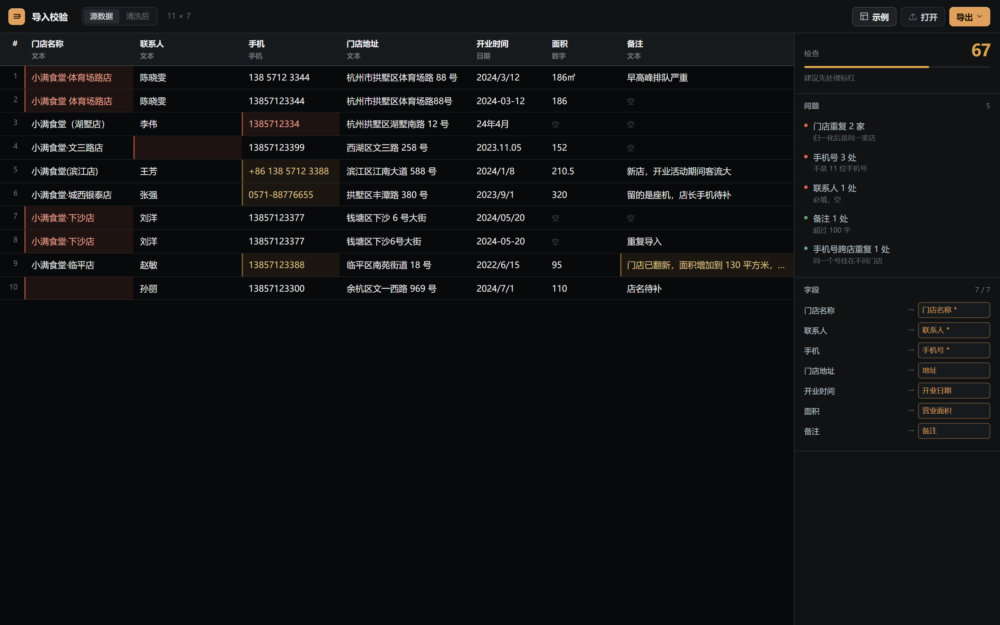
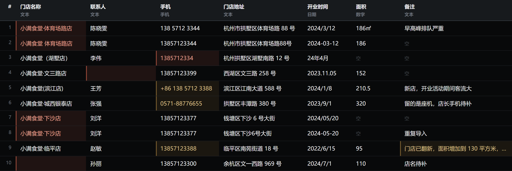
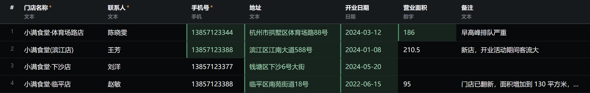

# 门店数据导入校验

客户提供的门店表在导入业务系统前，检查格式、重复与缺失，逐格标记问题，清洗后导出符合目标字段的标准数据。

## 快速开始

打开 `index.html`。点击「示例」载入内置样例，或拖入 CSV 文件；`样例数据.csv` 提供一份可直接使用的测试表。工具在浏览器内完成全部处理，文件不上传。

## 功能特性

- 读取 UTF-8 与 GBK 编码的 CSV，按解码结果自动回退，兼容中文 Excel 另存的表格。
- 按关键词把源列自动映射到七个目标字段，映射结果可在右侧面板逐列调整。
- 检查九类问题：必填为空、手机号格式、座机与国际区号、日期不可解析、数字列混文本、门店名重复、跨店手机号重复、整行重复、文本超长。
- 问题清单按严重程度排序，点击条目定位到对应单元格；表格用红格标出硬错误、黄格标出待确认项。
- 清洗阶段归一化手机号、日期、面积、地址与门店名，剔除必填缺失行与重复行，并在清洗视图标出改动过的格子。
- 导出两份 CSV：干净数据与问题报告，报告写明剔除行数与原因。

## 技术实现

单页原生 HTML / CSS / JavaScript，无框架、无构建步骤、无网络请求。

读取阶段先以 `TextDecoder('utf-8')` 解码，出现替换字符时改以 GBK 重解。列映射由 `SCHEMA` 中每个字段的关键词表匹配表头得出。校验结果写入 `state.cells`，按「行号-列号」索引，同一单元格多规则命中时保留最高等级。清洗时按字段类型调用归一化函数，去重依据为全部必填字段归一化后的组合键。

## 验收结果

本机无头浏览器逐项验收，11 项交互全部通过，页面 JS 错误 0 条，逐项数据见 `eval/验收结果.json`。详见 [验收报告](docs/验收报告.md)。

| 项目 | 实测 |
| --- | --- |
| 内置样例 | 11 × 7（表头 1 行、数据 10 行） |
| 检出问题 | 5 类：门店重复、手机号、联系人、备注、跨店手机号重复 |
| 列自动映射 | 7 / 7 |
| 格级标记 | 红格 7、黄格 4 |
| 导出 | 干净数据 5 行、问题报告 11 行 |
| 编码识别 | UTF-8 与 GBK 样例均正常解析 |

## 已知限制

- 仅支持 CSV；`xlsx` 需先另存。
- 列名依赖关键词匹配，「甲方」「门店代号」这类表头需手动指定。
- 日期仅识别年月日格式，带时分秒的值会判为不可解析。
- 手机号仅覆盖大陆号段，其他地区号码会被标记为错误。
- 超过 5000 行未做虚拟滚动，渲染会变慢。
- 目标字段固定为门店档案，切换到客户表或设备清单需修改 `js/app.js` 顶部的 `SCHEMA`。
